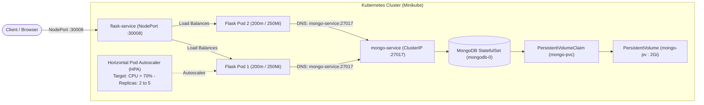

# Kubernetes Deployment for Python Flask & Authenticated MongoDB

**Intern Assignment** | Author: Utkarsh Saxena  
Docker Hub: [`utkarsh01saxena/flask-mongodb-app:latest`](https://hub.docker.com/r/utkarsh01saxena/flask-mongodb-app)

---

## Architecture Overview



### System Components
* **Flask API Layer:** Deployed as a Kubernetes Deployment with a baseline of **2 replicas**, rolling update strategy, and HTTP health probes (`/`).
* **MongoDB Database Layer:** Deployed as a **StatefulSet** with authentication enabled (`--auth`). Mounted to a persistent directory (`/data/db`) through a `2Gi` PersistentVolumeClaim.
* **Network Isolation:** MongoDB is exposed strictly inside the cluster through a **ClusterIP** service on port `27017`. The Flask application is exposed to the local host via a **NodePort** service on port `30008`.
* **Autoscaling:** **HPA v2** monitors container CPU utilization and scales Flask pods between **2 and 5 replicas** when utilization exceeds **70%**.

---

## Building and Pushing the Docker Image

The Dockerfile is located at `flask-mongodb-app/Dockerfile`. It uses `python:3.9-slim`, runs as a dedicated unprivileged user (`appuser`, UID `10001`), and leverages layer caching.

### Build and Push Commands
```bash
# 1. Navigate to the project root
cd flask-mongodb-app

# 2. Build the Docker image
docker build -t utkarsh01saxena/flask-mongodb-app:latest .

# 3. Log in to Docker Hub
docker login

# 4. Push the image to the public registry
docker push utkarsh01saxena/flask-mongodb-app:latest
```

---

## Detailed Minikube Deployment Steps

Follow these steps to deploy and verify the application stack on Minikube:

### Step 1: Start Minikube & Enable Metrics Server
The Metrics Server is required by the Horizontal Pod Autoscaler to gather CPU metrics:
```bash
# Start Minikube with the Docker driver
minikube start --driver=docker

# Enable the metrics-server addon
minikube addons enable metrics-server

# Verify metrics-server is running
kubectl get pods -n kube-system -l k8s-app=metrics-server
```

### Step 2: Deploy Secrets and ConfigMaps
Create the sensitive credentials and non-sensitive configurations:
```bash
# Deploy MongoDB credentials (root user, password, URI)
kubectl apply -f k8s/01-mongo-secret.yaml

# Deploy database and application configurations
kubectl apply -f k8s/02-mongo-configmap.yaml
kubectl apply -f k8s/06-flask-configmap.yaml
```

### Step 3: Deploy Persistent Storage
Create the PersistentVolume and claim to ensure database persistence:
```bash
kubectl apply -f k8s/03-mongo-pv-pvc.yaml

# Verify the claim is bound
kubectl get pvc mongo-pvc
```

### Step 4: Deploy MongoDB StatefulSet & Service
```bash
# Deploy internal ClusterIP service
kubectl apply -f k8s/04-mongo-service.yaml

# Deploy MongoDB StatefulSet
kubectl apply -f k8s/05-mongo-statefulset.yaml

# Wait for MongoDB to become ready
kubectl rollout status statefulset/mongodb --timeout=120s
```

### Step 5: Deploy Flask Deployment, Service & Autoscaler
```bash
# Deploy Flask application (pulls utkarsh01saxena/flask-mongodb-app:latest)
kubectl apply -f k8s/07-flask-deployment.yaml

# Expose Flask externally via NodePort
kubectl apply -f k8s/08-flask-service.yaml

# Apply Horizontal Pod Autoscaler
kubectl apply -f k8s/09-flask-hpa.yaml

# Wait for Flask deployment rollout
kubectl rollout status deployment/flask-deployment --timeout=120s
```

*(Note: You can also deploy all manifests at once using `kubectl apply -f k8s/complete-deployment.yaml`).*

### Step 6: Verify Deployment Status
```bash
kubectl get pods,svc,hpa,pvc
```
Expected output:
* `flask-deployment-...` pods: `1/1 Running` (2 replicas)
* `mongodb-0` pod: `1/1 Running`
* `mongo-pvc`: `Bound`
* `flask-hpa`: `cpu: 0%/70%` (or actual usage percentage)

### Step 7: Access the Application
On Minikube with the Docker driver, open the tunnel to reach the NodePort service from your host browser:
```bash
minikube service flask-service
```
This opens the browser at the assigned localhost proxy URL (e.g., `http://127.0.0.1:<PORT>`).

---

## Technical Explanations

### 1. DNS Resolution for Inter-Pod Communication
* **CoreDNS Engine:** Kubernetes runs internal CoreDNS pods that monitor the API server for changes to Services and Endpoints.
* **Fully Qualified Domain Name (FQDN):**
  $$\text{mongo-service}.\text{default}.\text{svc}.\text{cluster}.\text{local}$$
* **Search Path Resolution:** Each pod receives an automatically generated `/etc/resolv.conf`:
  ```text
  nameserver 10.96.0.10
  search default.svc.cluster.local svc.cluster.local cluster.local
  ```
  When Flask connects to `mongo-service:27017`, the resolver appends `default.svc.cluster.local`, and CoreDNS resolves it to the internal virtual ClusterIP (`10.100.x.x`). `kube-proxy` then routes the TCP traffic to the healthy `mongodb-0` pod.

### 2. Resource Requests vs. Limits
Both Flask and MongoDB pods are configured with the requested resource specifications:
```yaml
resources:
  requests:
    cpu: "200m"     # 0.2 CPU cores (Scheduling guarantee)
    memory: "250Mi" # 250 MB RAM
  limits:
    cpu: "500m"     # 0.5 CPU cores (Hard ceiling)
    memory: "500Mi" # 500 MB RAM
```
* **Requests (`kube-scheduler`):** Guaranteed minimum resources needed to schedule a pod on a node. HPA uses the CPU request as the denominator when calculating utilization: `(Actual Usage / 200m) * 100`.
* **Limits (`Linux cgroups`):** Hard resource ceiling. If a pod attempts to use more than `500m` CPU, the Linux Completely Fair Scheduler (CFS) throttles CPU cycles. If memory exceeds `500Mi`, the kernel terminates the process (`OOMKilled / Exit 137`).
* **Quality of Service (QoS):** Because requests are lower than limits, Kubernetes assigns these pods **`Burstable`** QoS, allowing them to handle traffic bursts without risking node starvation.

### 3. Design Choices & Alternatives

| Component | Selected Option | Alternative Considered | Reason for Decision |
|---|---|---|---|
| **Database Workload** | **StatefulSet** | Deployment | Databases require stable persistent storage binding and deterministic pod identity (`mongodb-0`). Deployments treat pods as ephemeral and can corrupt shared volume locks. |
| **Database Service** | **ClusterIP** | NodePort / LoadBalancer | The database must only be accessible from inside the cluster. ClusterIP prevents external access from the host or internet. |
| **API Exposure** | **NodePort (:30008)** | LoadBalancer / Ingress | On local Minikube, NodePort allows direct access via `minikube ip:30008` without requiring cloud provider load balancers or ingress DNS controllers. |
| **Credentials** | **Kubernetes Secrets** | ConfigMap / Plain Env | Passwords should not be committed in plain text to source control. Secrets support base64 encoding and Kubernetes RBAC restriction. |
| **Autoscaling Metric**| **CPU (70%)** | Memory Utilization | Web request surges cause immediate CPU spikes due to JSON parsing and DB socket I/O. Python memory does not drop immediately due to garbage collection behavior. |

---

## Cookie Points & Testing Scenarios

### Cookie Point 1: Benefits of Python Virtual Environments
1. **Dependency Isolation:** Prevents conflicts when different projects require incompatible versions of the same library (e.g., Flask 2.0.2 vs Flask 3.x).
2. **System OS Protection:** Avoids modifying or breaking system-level Python utilities that rely on default operating system packages.
3. **Reproducibility:** Ensures consistent and deterministic builds by freezing exact dependencies in `requirements.txt`.

---

### Cookie Point 2: Testing Scenarios & Results

All test scenarios were executed and verified locally. The screenshots are saved in the `screenshots/` directory:

#### 1. Functional Endpoint Tests (`01-local-endpoint-tests.png`)
Executed `python scripts/test_endpoints.py http://127.0.0.1:58313`:
* `GET /`: Returned `Welcome to the Flask app! The current time is: ...` (HTTP 200).
* `POST /data`: Inserted sample JSON document, returned `{"status": "Data inserted"}` (HTTP 201).
* `GET /data`: Retrieved stored records excluding `_id` (HTTP 200).
* `GET /health`: Verified MongoDB ping and healthy status (HTTP 200).


#### 2. Docker Image Build & Push (`02-docker-build-push.png`)
The Flask image was tagged and pushed to Docker Hub:
* Command: `docker push utkarsh01saxena/flask-mongodb-app:latest`
* Digest: `sha256:44d82e64b8ae818b9ff361baff45b25e714a94cb4f821ca1a17132cc0415ef14` (Size: 856 bytes manifest).


#### 3. Kubernetes Full Stack State (`03-kubernetes-resources.png`)
Verified all resources via `kubectl get pods,svc,hpa,pvc`:
* `flask-deployment-6b49955fd9-kbzmb` and `xz2ms`: `1/1 Running` (2 replicas).
* `mongodb-0`: `1/1 Running`.
* `flask-service`: NodePort `10.108.128.67:5000` mapped to `30008`.
* `mongo-service`: ClusterIP `10.100.201.44:27017`.
* `mongo-pvc`: `Bound` to `mongo-pv` (2Gi).


#### 4. Database Persistence Verification (`04-persistence-test.png`)
Tested data survival across pod deletion:
1. Inserted record via `Invoke-RestMethod`: `{"assignment":"Kubernetes","proof":"Persistence Verified"}` $\rightarrow$ `status: Data inserted`.
2. Verified data via `curl.exe /data`.
3. Deleted the database pod: `kubectl delete pod mongodb-0`.
4. Monitored StatefulSet recreation: new `mongodb-0` pod was running within 11 seconds.
5. Re-queried `curl.exe /data`: Both the previous and newly inserted documents were returned intact, proving storage persistence via `mongo-pvc`.


#### 5. High-Traffic Load Simulation & Autoscaling Results (`05-hpa-autoscaling.png`)
To simulate high traffic, a load generator was deployed inside the cluster:
```bash
kubectl run load-gen --image=busybox:1.28 --restart=Never -- /bin/sh -c "while true; do wget -q -O- http://flask-service:5000/ > /dev/null; done"
```

**Measured Autoscaling Lifecycle (Captured via `kubectl get hpa flask-hpa -w`):**
* **Baseline State (43m):** 2 replicas, CPU utilization at **`0%/70%`**.
* **Traffic Ramping (44m):** CPU utilization rose to **`45%/70%`**.
* **Traffic Surge (45m):** CPU utilization surged to **`171%/70%`**, significantly exceeding the 70% threshold.
* **Scale-Up to 4 Replicas (45m):** HPA immediately triggered scale-up from 2 to **4 replicas**.
* **Scale-Up to Max 5 Replicas (46m):** High CPU demand (`171%`) persisted, prompting HPA to scale to the configured maximum ceiling of **5 replicas**.
* **Load Absorption (46m - 47m):** Requests distributed across 5 active pods, dropping CPU to **`116%/70%`**, then down below target to **`56%/70%`**.
* **Graceful Scale-Down (48m):** Once traffic ceased, HPA observed the cooldown stabilization window and scaled pods back to the baseline minimum of **2 replicas** (`0%/70%`).


---

## Issues Encountered & Resolutions

1. **Metrics Server Discovery Delay:**  
   *Issue:* HPA initially showed `cpu: <unknown>/70%`.  
   *Fix:* Enabled the metrics addon via `minikube addons enable metrics-server` and confirmed CPU requests were explicitly set in the deployment manifest. Metrics appeared within 60 seconds.
2. **MongoDB Authentication Scope (`authSource=admin`):**  
   *Issue:* The root user created via `MONGO_INITDB_ROOT_USERNAME` is stored in the `admin` authentication database. Connecting directly to `flask_db` failed authentication.  
   *Fix:* Updated the connection logic in `app.py` to append `?authSource=admin` to the URI so authentication validates against the correct administrative database.
3. **PowerShell Argument Parsing with JSON:**  
   *Issue:* Windows PowerShell strips inner double quotes when running `curl -d '{"key":"value"}'`, causing a 400 Bad Request error.  
   *Fix:* Used native PowerShell `Invoke-RestMethod` with `-Body` or `curl.exe` with escaped quotes (`\"key\":\"value\"`).

---

## Project Layout

```text
.
├── README.md                      # Project documentation
├── .gitignore                     # Git exclusion rules
├── flask-mongodb-app/             # Application source code & Dockerfile
│   ├── app.py                     # Flask application
│   ├── Dockerfile                 # Container specification
│   ├── requirements.txt           # Dependencies
│   ├── .dockerignore              # Docker build exclusions
│   └── .env.example               # Reference environment variables
├── k8s/                           # Kubernetes manifests
│   ├── 00-namespace.yaml          # Dedicated namespace
│   ├── 01-mongo-secret.yaml       # Base64 MongoDB credentials
│   ├── 02-mongo-configmap.yaml    # Database configuration
│   ├── 03-mongo-pv-pvc.yaml       # Persistent storage (2Gi)
│   ├── 04-mongo-service.yaml      # ClusterIP service
│   ├── 05-mongo-statefulset.yaml  # MongoDB StatefulSet
│   ├── 06-flask-configmap.yaml    # Flask configuration
│   ├── 07-flask-deployment.yaml   # Flask Deployment (2 replicas)
│   ├── 08-flask-service.yaml      # NodePort service (:30008)
│   ├── 09-flask-hpa.yaml          # Horizontal Pod Autoscaler
│   └── complete-deployment.yaml   # All-in-one manifest
├── screenshots/                   # Verification screenshots
│   ├── 01-local-endpoint-tests.png
│   ├── 02-docker-build-push.png
│   ├── 03-kubernetes-resources.png
│   ├── 04-persistence-test.png
│   └── 05-hpa-autoscaling.png
├── scripts/                       # Deployment and load testing scripts
│   ├── deploy.ps1 / deploy.sh
│   ├── load_test.ps1 / load_test.sh
│   ├── test_endpoints.py
│   └── cleanup.sh
└── tests/                         # Unit tests
    └── test_app.py
```
