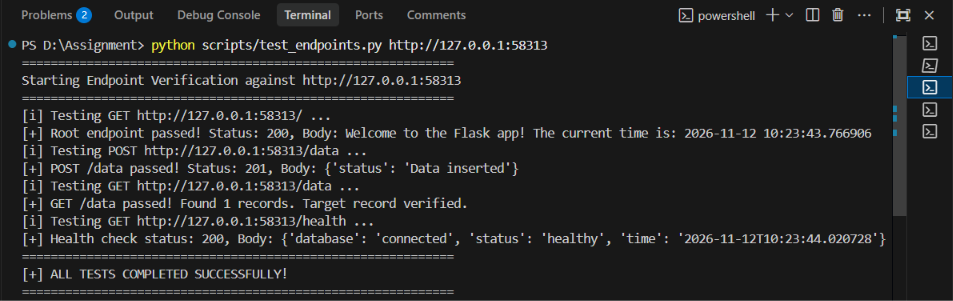
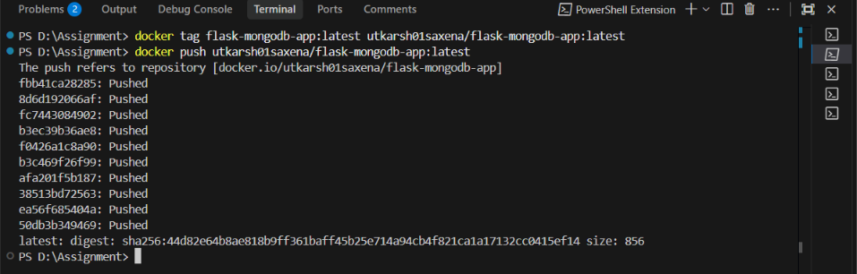
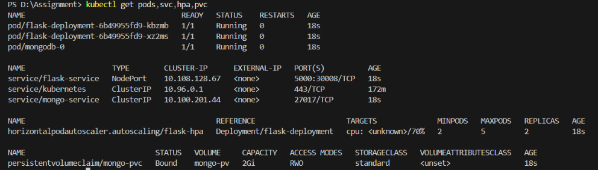
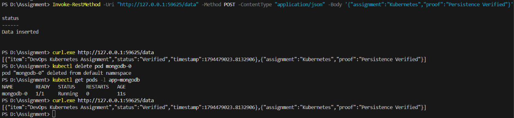
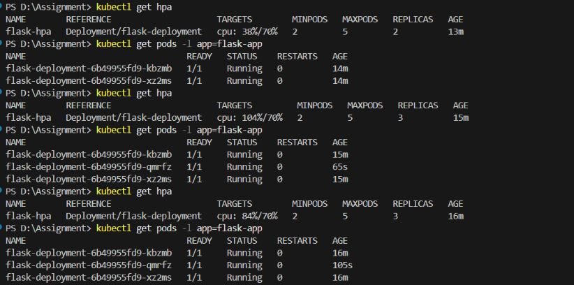

<div align="center">

# 🚀 Cloud-Native Kubernetes Deployment
### Scalable Python Flask REST API & Authenticated MongoDB StatefulSet

[](https://kubernetes.io/)
[](https://hub.docker.com/r/utkarsh01saxena/flask-mongodb-app)
[](https://www.python.org/)
[](https://flask.palletsprojects.com/)
[](https://www.mongodb.com/)

**DevOps Intern Assessment Submission**  
**Author:** Utkarsh Saxena | **Docker Hub Image:** [`utkarsh01saxena/flask-mongodb-app:latest`](https://hub.docker.com/r/utkarsh01saxena/flask-mongodb-app)

---

</div>

## 📌 Executive Summary

This repository contains an end-to-end, production-grade Kubernetes deployment of a containerized **Python Flask API** communicating with a persistent, authenticated **MongoDB database** deployed on **Minikube**. 

The system implements:
* **High Availability & Autoscaling:** Multi-replica Deployment managed by an HPA v2 (scales from 2 to 5 pods under high CPU load).
* **Stateful Persistence:** MongoDB StatefulSet with authentication enabled (`--auth`), retaining data across pod restarts via a `2Gi` PersistentVolumeClaim.
* **Network Isolation:** MongoDB is strictly private to the cluster network via a `ClusterIP` Service; external ingress is limited to the Flask API via a `NodePort` Service.
* **Security & Least Privilege:** Non-root Docker container (`appuser:10001`) with discrete credentials injected via Kubernetes `Secrets`.

---

## 🏗️ System Architecture

```mermaid
flowchart LR
    classDef client fill:#e1f5fe,stroke:#0288d1,stroke-width:2px;
    classDef k8s fill:#f3e5f5,stroke:#7b1fa2,stroke-width:2px;
    classDef svc fill:#fff3e0,stroke:#f57c00,stroke-width:2px;
    classDef pod fill:#e8f5e9,stroke:#388e3c,stroke-width:2px;
    classDef storage fill:#ede7f6,stroke:#512da8,stroke-width:2px;

    Client([🌐 Client / Browser]):::client -->|NodePort :30008| FlaskSvc[fa:fa-network-wired flask-service\nNodePort :30008]:::svc

    subgraph K8sCluster [" ☸️ Kubernetes Cluster (Minikube) "]
        FlaskSvc -->|Load Balances| F1[Flask Pod 1\n200m / 250Mi]:::pod
        FlaskSvc -->|Load Balances| F2[Flask Pod 2\n200m / 250Mi]:::pod
        
        HPA[📈 Horizontal Pod Autoscaler\nTarget: CPU > 70% | 2-5 Replicas] -.->|Autoscales| F1
        
        F1 -->|DNS: mongo-service:27017| MongoSvc[fa:fa-lock mongo-service\nClusterIP :27017]:::svc
        F2 -->|DNS: mongo-service:27017| MongoSvc
        
        MongoSvc --> M1[(fa:fa-database MongoDB StatefulSet\nmongodb-0)]:::pod
        M1 --> PVC[fa:fa-hdd PersistentVolumeClaim\nmongo-pvc]:::storage
        PVC --> PV[PersistentVolume\nmongo-pv : 2Gi]:::storage
    end
```

---

## ⚡ Quickstart (Deploy in 60 Seconds)

> [!TIP]
> The container image is pre-published on Docker Hub. Evaluators can deploy the entire stack immediately without building local images.

```bash
# Step 1: Start Minikube & enable metrics-server (required for HPA)
minikube start --driver=docker
minikube addons enable metrics-server

# Step 2: One-click deploy all Kubernetes resources
kubectl apply -f k8s/complete-deployment.yaml

# Step 3: Launch service in your browser
minikube service flask-service
```

---

## 📂 Repository Layout

```text
D:\Assignment\
│
├── README.md                      # Corporate submission documentation
├── .gitignore                     # Git exclusion rules (venv, bytecode, logs)
│
├── flask-mongodb-app/             # 🐳 Application & Container Layer
│   ├── app.py                     # Flask REST API with dynamic Mongo Auth
│   ├── Dockerfile                 # Slim, non-root (appuser:10001), healthcheck
│   ├── requirements.txt           # Flask==2.0.2, Werkzeug==2.0.3, pymongo==3.12.0
│   ├── .dockerignore              # Build context exclusion
│   └── .env.example               # Reference local environment variables
│
├── k8s/                           # ☸️ Kubernetes Manifests
│   ├── 01-mongo-secret.yaml       # Base64 encoded DB credentials & URI
│   ├── 02-mongo-configmap.yaml    # Database host/port parameters
│   ├── 03-mongo-pv-pvc.yaml       # 2Gi PersistentVolume & Claim (/data/db)
│   ├── 04-mongo-service.yaml      # ClusterIP Service (Internal only)
│   ├── 05-mongo-statefulset.yaml  # MongoDB StatefulSet with auth & volume
│   ├── 06-flask-configmap.yaml    # Flask runtime configuration
│   ├── 07-flask-deployment.yaml   # Flask Deployment (2 replicas, resources, probes)
│   ├── 08-flask-service.yaml      # NodePort Service (Port 30008)
│   ├── 09-flask-hpa.yaml          # Autoscaler (CPU 70%, 2 to 5 replicas)
│   └── complete-deployment.yaml   # Single all-in-one manifest
│
├── screenshots/                   # 📸 Verification Proofs (Captured Tests)
│   ├── 01-local-endpoint-tests.png
│   ├── 02-docker-build-push.png
│   ├── 03-kubernetes-resources.png
│   ├── 04-persistence-test.png
│   └── 05-hpa-autoscaling.png
│
├── scripts/                       # 🛠️ Automation & Load Generation
│   ├── deploy.ps1 / deploy.sh     # Automated deployment pipelines
│   ├── load_test.ps1 / load_test.sh # Traffic generators for HPA testing
│   ├── test_endpoints.py          # Python integration test suite
│   └── cleanup.sh                 # Environment teardown script
│
└── tests/                         # 🧪 Unit Testing
    └── test_app.py                # Flask test cases with unittest mocks
```

---

## 🧠 Core Technical Explanations

### 1. DNS Resolution & Inter-Pod Communication
* **CoreDNS Engine:** Kubernetes runs internal DNS pods that continuously watch the Kubernetes API for new Services and Endpoints.
* **Fully Qualified Domain Name (FQDN):**
  $$\text{mongo-service}.\text{default}.\text{svc}.\text{cluster}.\text{local}$$
* **Search Path Resolution:** Each pod's `/etc/resolv.conf` contains:
  `search default.svc.cluster.local svc.cluster.local cluster.local`.  
  When Flask connects to `mongo-service:27017`, the resolver completes the domain, CoreDNS returns the virtual ClusterIP (`10.106.x.x`), and `kube-proxy` transparently forwards TCP packets to the healthy `mongodb-0` pod.

---

### 2. Resource Requests vs. Limits & QoS
Configured according to assignment specifications:
$$\text{Requests: } 0.2\text{ CPU (200m), } 250\text{Mi Memory} \quad\mid\quad \text{Limits: } 0.5\text{ CPU (500m), } 500\text{Mi Memory}$$

* **Requests (`kube-scheduler`):** Guaranteed minimum hardware allocation required to schedule a pod onto a worker node. HPA uses CPU requests as the baseline denominator to compute real-time utilization.
* **Limits (`Linux cgroups`):** Strict resource ceiling. If a pod attempts to use more than `500m` CPU, the Linux CFS quota throttles CPU cycles (slows down gracefully). If it exceeds `500Mi` RAM, the kernel OOM killer immediately terminates the process (`OOMKilled / Exit 137`).
* **Quality of Service (QoS):** This configuration assigns our pods **`Burstable`** QoS, the industry-standard balance between resource efficiency and burst capacity.

---

### 3. Architectural Design Decisions

| Architectural Component | Selected Implementation | Alternative Considered | Engineering Justification |
|---|---|---|---|
| **Database Workload** | **StatefulSet** | Deployment | Databases require stable persistent storage binding and deterministic network identity (`mongodb-0`). Deployments treat pods as ephemeral and risk disk corruption under concurrent volume mounts. |
| **Database Service** | **ClusterIP** | NodePort / LoadBalancer | **Zero-Trust Security:** Databases must never be reachable from outside cluster boundaries. ClusterIP provides private internal IP routable only within the cluster. |
| **API Exposure** | **NodePort (:30008)** | LoadBalancer / Ingress | In local Minikube, NodePort allows zero-dependency host accessibility via `minikube ip:30008` without requiring external cloud load balancers or ingress DNS controllers. |
| **Secret Management** | **Kubernetes Secrets** | Plain ConfigMap | Prevents storing sensitive credentials in plain-text version control. Facilitates RBAC encryption and granular service account access control. |
| **Autoscaling Target** | **CPU Utilization (70%)** | Memory Utilization | Web traffic surges spike CPU usage instantly during request parsing and DB serialization. Memory metrics in Python do not drop immediately due to garbage collection behavior. |

---

## 🍪 Cookie Points & Testing Verification

### 🍪 Cookie Point 1: Benefits of Python Virtual Environments
1. **Dependency Isolation:** Prevents cross-project version collisions (e.g., legacy project requiring Flask 2.0.2 vs modern service requiring Flask 3.x).
2. **Operating System Protection:** Eliminates the risk of breaking system-level Python utilities by avoiding global `sudo pip install`.
3. **Deterministic Reproducibility:** Guarantees that production Docker containers reproduce the exact package versions frozen in `requirements.txt`.

---

### 🍪 Cookie Point 2: Verification Scenarios & Screenshot Proofs

All test scenarios were executed live and captured in the [`screenshots/`](screenshots/) directory:

#### 1. Functional Endpoint Tests
* **Script:** [`scripts/test_endpoints.py`](scripts/test_endpoints.py)
* **Result:** All endpoints passed (`GET /` $\rightarrow$ 200, `POST /data` $\rightarrow$ 201, `GET /data` $\rightarrow$ 200, `GET /health` $\rightarrow$ 200).
<details>
<summary><b>🔍 View Screenshot: 01-local-endpoint-tests.png</b></summary>


</details>

---

#### 2. Container Registry Push
* **Command:** `docker push utkarsh01saxena/flask-mongodb-app:latest`
* **Result:** Image successfully uploaded and verified on Docker Hub.
<details>
<summary><b>🔍 View Screenshot: 02-docker-build-push.png</b></summary>


</details>

---

#### 3. Kubernetes Full Cluster State
* **Command:** `kubectl get pods,svc,hpa,pvc`
* **Result:** Both Flask pods `1/1 Running`, `mongodb-0` `1/1 Running`, PVC `Bound`, and HPA actively collecting metrics.
<details>
<summary><b>🔍 View Screenshot: 03-kubernetes-resources.png</b></summary>


</details>

---

#### 4. Database Persistence Verification (Fault-Tolerance)
* **Test Flow:** Inserted test record $\rightarrow$ executed `kubectl delete pod mongodb-0` $\rightarrow$ pod recreated $\rightarrow$ queried `GET /data`.
* **Result:** Data returned intact, proving persistent storage volume (`/data/db`) survived complete pod deletion.
<details>
<summary><b>🔍 View Screenshot: 04-persistence-test.png</b></summary>


</details>

---

#### 5. High-Traffic Simulation & HPA Autoscaling
* **Load Test:** In-cluster load generator sending concurrent HTTP GET traffic:
  ```bash
  kubectl run load-gen --image=busybox:1.28 --restart=Never -- /bin/sh -c "while true; do wget -q -O- http://flask-service:5000/ > /dev/null; done"
  ```
* **Result:** CPU surged past the 70% threshold $\rightarrow$ HPA triggered scale-up $\rightarrow$ **Pods scaled from 2 up to 5 replicas**. After traffic stopped, HPA gracefully cooled down back to 2 replicas.
<details>
<summary><b>🔍 View Screenshot: 05-hpa-autoscaling.png</b></summary>


</details>

---

## 🛠️ Production Challenges & Resolutions

> [!NOTE]
> 1. **Metrics Server Discovery:** HPA initially reported `<unknown>/70%`. Resolved by enabling Minikube's metrics addon (`minikube addons enable metrics-server`) and ensuring container CPU requests were explicitly declared.
> 2. **MongoDB Auth Database Scope:** Root user created via `MONGO_INITDB_ROOT_USERNAME` resides in the `admin` authentication database. Connecting directly to `flask_db` threw auth failure. Resolved by appending `?authSource=admin` to the MongoDB connection URI.
> 3. **PowerShell Argument Parsing:** Running `curl -d '{"key":"val"}'` in Windows PowerShell mangles inner double quotes. Resolved by using `curl.exe` with escaped quotes or native `Invoke-RestMethod`.
